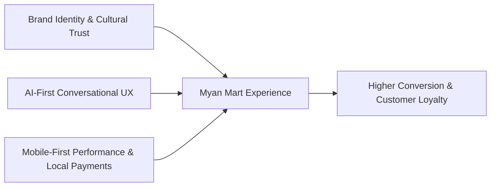
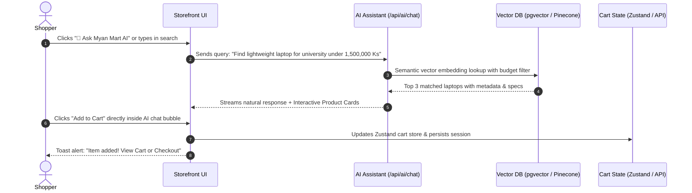
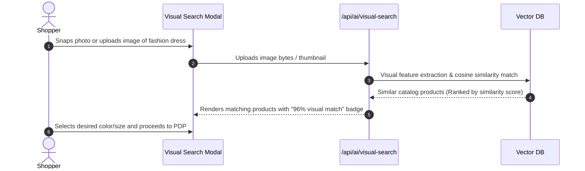
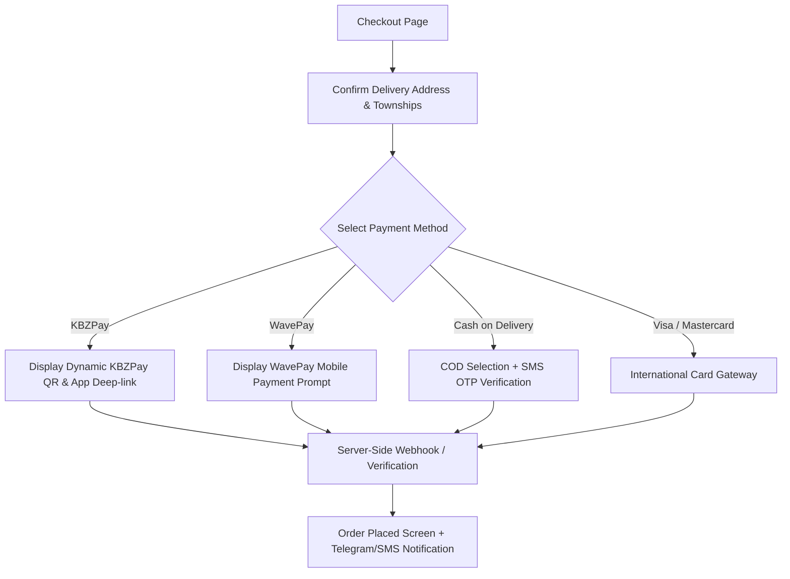

# Myan Mart – UI/UX & Design System Specification

**Companion Document to:** [`myan_mart_ai_integration_blueprint.md`](file:///c:/Users/Admin/Desktop/Myan%20Mart/myan_mart_ai_integration_blueprint.md)  
**Platform:** Myan Mart (`myanmart.com`)  
**Target Market:** Myanmar (Domestic & Cross-Border E-Commerce)  
**Version:** 1.0.0  
**Status:** Approved for Implementation  

---

## 1. Executive Summary & Design Philosophy

The Myan Mart design system is tailored for a mobile-first, high-growth Southeast Asian e-commerce landscape. By fusing cutting-edge AI capabilities (conversational shopping, multimodal visual search, and semantic discovery) with deep local resonance (Myanmar Kyat [MMK], KBZPay/WavePay, bilingual Unicode typography), Myan Mart offers an intuitive, accessible, and delightful retail experience.



### Core Design Pillars

1. **AI Without Friction:** AI is not a gimmick; it is an intelligent concierge. Chat and visual search are integrated seamlessly into the standard shopping flow with one-click actions, interactive product cards, and instant filtering.
2. **Mobile & Bandwidth Conscious:** Optimized for low-latency interactions across 3G/4G/5G networks with progressive image loading, skeleton loaders, and tactile touch targets (min 44×44px).
3. **Cultural Resonance & Dual-Script Harmony:** Native support for both Burmese (Myanmar Unicode) and English, maintaining visual symmetry across differing font metrics and line heights.
4. **Confidence & Transactional Trust:** Clear price tags in Myanmar Kyat (`Ks` / `MMK`), transparent delivery estimates, verified merchant badges, and friction-free mobile wallet checkout flows.

---

## 2. Brand Identity & Visual Design System

### 2.1 Color Palette

The color strategy pairs lacquer red and turmeric gold with thanaka-inspired warm neutrals and jade-green trust cues. This palette brings a local market character to the storefront while keeping prices, controls, and bilingual content easy to scan.

| Swatch Role | Color Name | Hex Code | Tailwind Token | Usage Context |
| :--- | :--- | :--- | :--- | :--- |
| **Primary** | Lacquer Red | `#9C382A` | `brand-600` | Brand accents, primary CTAs, active states |
| **Primary Hover** | Deep Lacquer | `#7B2C22` | `brand-700` | Button hover and pressed states |
| **Primary Light** | Lacquer Tint | `#F4D9D1` | `brand-100` | User message bubbles, badge backgrounds, selected states |
| **Accent / Trust** | Turmeric Gold | `#D39A37` | `amber-500` | Promotions, ratings, highlights and local craft details |
| **Success / Wallet** | Market Jade | `#3F8061` | `emerald-500` | In-stock indicators, payment confirmations, trust cues |
| **Background Light** | Thanaka Paper | `#FAF7F0` | `bg-page` | Page canvas and warm surrounding surfaces |
| **Surface Muted** | Woven Cotton | `#F3EEE4` | `surface-muted` | Secondary panels and neutral card backgrounds |
| **Border / Divider** | Warm Sand | `#E9E1D3` | `border-light` | Card borders and structural dividers |
| **Text Primary** | Dark Teak | `#2D2923` | `text-main` | Primary titles, prices and critical labels |
| **Text Muted** | Soft Teak | `#766E62` | `text-muted` | Category labels, timestamps and secondary specs |

### 2.2 Typography System

Myan Mart enforces strict Unicode compliance (avoiding legacy Zawgyi) alongside clean modern sans-serif typography.

* **Primary Latin Font:** `Inter`, system-ui, -apple-system, sans-serif
* **Primary Myanmar Font:** `Noto Sans Myanmar`, `Padauk`, `Pyidaungsu`
* **Display / Accent Font:** `Outfit`, sans-serif (for marketing banners and promotional hero numbers)

#### Type Scale Hierarchy

| Token | Size | Line Height | Weight | Application |
| :--- | :--- | :--- | :--- | :--- |
| `text-xs` | 12px (0.75rem) | 16px | 400 / 500 | Badges, timestamps, secondary specs, microcopy |
| `text-sm` | 14px (0.875rem) | 20px | 400 / 500 | AI Chat messages, input placeholders, filter labels |
| `text-base` | 16px (1.00rem) | 24px | 400 / 600 | Body text, standard product card titles, buttons |
| `text-lg` | 18px (1.125rem) | 28px | 600 / 700 | Product card prices, section headers, tab labels |
| `text-xl` | 20px (1.25rem) | 28px | 600 / 700 | Modal titles, category carousel headers |
| `text-2xl` | 24px (1.50rem) | 32px | 700 | PDP product titles, checkout summary headers |
| `text-3xl` | 30px (1.875rem) | 36px | 800 | Hero promo banners, seasonal campaign headlines |

### 2.3 Elevation, Radius & Shadows

* **Border Radius:**
  * Small elements (Badges, tags): `rounded-md` (6px)
  * Inputs, interactive buttons: `rounded-lg` (8px)
  * Product cards, flyout drawers, AI Chat container: `rounded-2xl` (16px)
  * Floating action buttons, AI trigger bubble: `rounded-full` (9999px)
* **Shadow Hierarchy:**
  * `shadow-sm`: Flat product cards, list items
  * `shadow-md`: Hovered product cards, dropdown menus
  * `shadow-xl`: AI Floating Chat Assistant, sticky bottom checkout bar
  * `shadow-2xl`: Quick-view modals, full-screen visual search dialog

---

## 3. Information Architecture (IA) & User Navigation

### 3.1 Storefront Site Architecture

```mermaid
graph TD
    Home[Storefront Home /]
    Search[AI Semantic & Visual Search /(shop)/search]
    Categories[Category Explorer /(shop)/category/[id]]
    PDP[Product Detail Page /(shop)/product/[id]]
    Cart[Cart Drawer / Sticky Cart Sheet]
    Checkout[Checkout & Local Wallets /checkout]
    ChatOverlay[AI Shopping Assistant Floating Widget]

    Home --> Search
    Home --> Categories
    Home --> ChatOverlay
    Categories --> PDP
    Search --> PDP
    ChatOverlay -.->|Direct Add to Cart| Cart
    ChatOverlay -.->|Recommendation Link| PDP
    PDP --> Cart
    Cart --> Checkout
```

### 3.2 Global Header Layout Specification

The header balances commercial navigation with prominent AI capabilities:

```text
+----------------------------------------------------------------------------------------------------+
|  MYAN MART [Logo]  |  [ Search products, brands, or ask AI...          (📷) (🔍) ]  |  [MM/EN] [User] [Cart(3)] |
+----------------------------------------------------------------------------------------------------+
|  [All Categories ▾]  Electronics  Fashion  Beauty  Home & Living  Groceries  Toys  ⚡ Today's Flash Deals  |
+----------------------------------------------------------------------------------------------------+
```

* **Smart Omnibox Search Bar:**
  * Left: Search icon `MagnifyingGlass`
  * Center: Dynamic placeholder animating through sample AI queries (*"Ask for: 'waterproof running shoes under 80,000 Ks'"*, *"natural tea tree skincare"*)
  * Right:
    * `Camera` icon: Triggers Multimodal Visual Search modal
    * `Sparkles` icon / `Ask AI`: Switches query mode directly into conversational search

---

## 4. Key User Journeys & Interactive Flows

### 4.1 Flow: AI-Powered Natural Language Discovery to Cart



### 4.2 Flow: Multimodal Visual Search



### 4.3 Flow: Localized Myanmar Payment Checkout



---

## 5. UI Component Specifications & Layout Wireframes

### 5.1 Product Discovery Card (`src/components/catalog/product-card.tsx`)

Each card is engineered for clarity, fast rendering, and instant AI insights.

```text
+------------------------------------------+
|  [🏷️ 15% OFF]            [🤍 Favorite]   |
|                                          |
|                [ Product ]               |
|                [  Image  ]               |
|                                          |
+------------------------------------------+
|  Brand Name • Electronics                |
|  Logitech MX Master 3S Wireless Mouse    |
|  ⭐⭐⭐⭐⭐ (4.9) • 120 sold               |
|                                          |
|  285,000 Ks         <span class="line-through">335,000 Ks</span>  |
|  ✨ "Top pick for coders & office users" |
+------------------------------------------+
|       [ 🛒 Add to Cart ]                 |
+------------------------------------------+
```

* **Attributes:**
  * Discount badge top-left: Red background (`#DC2626`), white text.
  * AI Micro-Summary badge bottom-center: Subtle Amber tint (`#FEF3C7`), `text-amber-800` with sparkle icon.
  * Pricing: Bold prominent numeral formatted with commas (e.g., `285,000 Ks`).
  * Action: Full-width button with touch-friendly 42px height.

---

### 5.2 AI Shopping Assistant Floating Widget (`src/components/ai/shopping-assistant.tsx`)

The companion AI assistant evolves the basic snippet into a full production-grade e-commerce concierge.

#### Collapsed Floating Trigger
* Position: `fixed bottom-6 right-6 z-50`
* Shape: Pill or circular FAB with notification pulse
* Color: `bg-red-600 hover:bg-red-700 text-white shadow-2xl`
* Icon: Modern robot/chat icon + `"Ask AI"` label + animated shimmer pill

#### Expanded Chat Interface Layout

```text
+-----------------------------------------------------+
| [🤖] Myan Mart AI Concierge               [—] [✕]  |
|      Online • Powered by GPT-4o                     |
+-----------------------------------------------------+
| [AI]: Mingalarbar! Looking for electronics, shoes,  |
|       or beauty deals today?                        |
|                                                     |
| [Quick Chips]:                                      |
| [Best Laptops Under 2M Ks]  [Skincare for Dry Skin] |
|                                                     |
| [User]: Show me red running shoes size 42           |
|                                                     |
| [AI]: Here are top rated picks in stock right now:  |
| +-------------------------------------------------+ |
| | [Img] Nike Air Zoom Pegasus 40                  | |
| |       Price: 380,000 Ks • Size 42 In-Stock      | |
| |       [View Details]   [+ Add to Cart]          | |
| +-------------------------------------------------+ |
+-----------------------------------------------------+
| [ Type your request or ask for recommendations... ] |
| [ 📷 ] [ Voice 🎙️ ]                         [ Send ➔ ] |
+-----------------------------------------------------+
```

* **Micro-interactions:**
  * **Typing / Streaming State:** Glowing 3-dot pulse animation or markdown word-by-word streaming effect.
  * **Interactive Cart Button:** Clicking `[+ Add to Cart]` inside the AI chat displays an inline confirmation checkmark (`Added!`) without closing the chat drawer.
  * **Suggested Follow-up Prompts:** Floating action chips horizontal scroll container above the input field.

---

### 5.3 Product Detail Page (PDP) Layout

Designed for high conversion with rich media and AI intelligence summaries.

```text
+-----------------------------------------------------------------------------------------+
| Breadcrumbs: Home > Electronics > Audio > Sony WH-1000XM5                                |
+----------------------------------------------------+------------------------------------+
|                                                    | Sony WH-1000XM5 Wireless Headphones |
|                 PRIMARY IMAGE                      | Brand: Sony | SKU: SNY-XM5-BLK      |
|                 (High-Res Zoom)                    | ⭐⭐⭐⭐⭐ 4.8 (84 customer reviews) |
|                                                    +------------------------------------+
|                                                    | Price: 1,150,000 Ks                |
|                                                    | Installment: From 95,800 Ks/mo     |
| [Thumb 1]  [Thumb 2]  [Thumb 3]  [Thumb 4]        +------------------------------------+
|                                                    | Color: [Black ●]  [Silver ⚪]       |
|                                                    | Quantity: [ -  1  + ]  (14 in stock)|
|                                                    +------------------------------------+
|                                                    | [ 🛒 Add to Cart ]   [ Buy Now ⚡ ]|
+----------------------------------------------------+------------------------------------+
|  ✨ AI Product Analysis (Generated from 84 verified buyer reviews):                      |
|  • Pros: Industry-leading noise cancellation, 30hr battery life, crystal-clear mic calls|
|  • Cons: Does not fold as compactly as XM4 predecessor                                 |
|  • Best Suited For: Frequent flyers, developers, and remote workers                      |
+-----------------------------------------------------------------------------------------+
|  Technical Specifications | Verified Reviews | Similar AI Vector Matches               |
+-----------------------------------------------------------------------------------------+
```

---

### 5.4 Checkout & Local Payment Matrix

Localized specifically for Myanmar buyers with clear step indicators:

1. **Delivery Address:**
   * Dropdowns for Division / State (e.g., Yangon, Mandalay, Naypyitaw)
   * Township selector (e.g., Kamayut, Hledan, Bahan, Sanchaung)
   * Detailed street address & contact phone number (09-XXXXXXXXX format validation)
2. **Payment Methods UI:**
   * **KBZPay (KPay):** Dedicated card displaying KBZ logo. On mobile, triggers deep-link app switch; on desktop, renders secure QR Code with 10-minute expiry countdown.
   * **WavePay:** Dedicated Wave Money yellow/blue branding. Mobile number prompt with push notification confirmation.
   * **Cash on Delivery (COD):** Available for verified domestic accounts with Township availability badge.
   * **Credit / Debit Cards:** MPU, Visa, Mastercard for domestic/diaspora checkout.

---

## 6. Generative UI & Design-to-Code Tokens

### 6.1 Tailwind CSS Theme Configuration (`tailwind.config.ts`)

```typescript
import type { Config } from 'tailwindcss';

const config: Config = {
  darkMode: ['class'],
  content: [
    './src/pages/**/*.{ts,tsx}',
    './src/components/**/*.{ts,tsx}',
    './src/app/**/*.{ts,tsx}',
  ],
  theme: {
    container: {
      center: true,
      padding: '1rem',
      screens: {
        '2xl': '1280px',
      },
    },
    extend: {
      colors: {
        brand: {
          50: '#FEF2F2',
          100: '#FEE2E2',
          200: '#FECACA',
          500: '#EF4444',
          600: '#DC2626', // Main Myan Mart Red
          700: '#B91C1C',
          900: '#7F1D1D',
        },
        accent: {
          gold: '#F59E0B',
          jade: '#10B981',
        },
        surface: {
          subtle: '#F8FAFC',
          card: '#FFFFFF',
          dark: '#0F172A',
        },
      },
      fontFamily: {
        sans: ['var(--font-inter)', 'var(--font-noto-myanmar)', 'system-ui', 'sans-serif'],
        display: ['var(--font-outfit)', 'sans-serif'],
      },
      borderRadius: {
        xl: '12px',
        '2xl': '16px',
        '3xl': '24px',
      },
      animation: {
        'pulse-subtle': 'pulse 3s cubic-bezier(0.4, 0, 0.6, 1) infinite',
        'shimmer': 'shimmer 2s linear infinite',
      },
      keyframes: {
        shimmer: {
          '0%': { backgroundPosition: '-200% 0' },
          '100%': { backgroundPosition: '200% 0' },
        },
      },
    },
  },
  plugins: [require('tailwindcss-animate')],
};

export default config;
```

---

## 7. Accessibility, Localization & Mobile UX Guardrails

### 7.1 Bilingual & Script Support
* **Unicode Enforcement:** All text components must render in clean Unicode. Include fallback detection for legacy devices to suggest Unicode font installation if needed.
* **Text Expansion Allowance:** Burmese text generally expands by approximately 15% to 25% in height and width compared to English. Button heights and label containers must use `min-h-[...]` rather than rigid fixed pixel heights to avoid clipping diacritics.

### 7.2 Touch & Ergonomics (Mobile-First)
* Primary navigation, cart drawer actions, and the AI Assistant trigger are positioned in the **"Thumb Zone"** (lower 40% of the mobile screen viewport).
* All clickable elements observe a minimum touch target size of **44 × 44 pt / px**.

### 7.3 Progressive Loading & Resilience
* High-resolution product images must use Next.js `<Image>` with blur-up placeholders (`placeholder="blur"`).
* AI endpoints stream text progressively so users experience zero perceived lag (< 400ms time to first token).
* Graceful network fallback: If vector or LLM services experience latency, the search bar seamlessly falls back to PostgreSQL standard full-text search without breaking page layout.

---

## 8. Summary of Deliverables & Implementation Checklist

- [x] Brand Colors, Typography, & Design Tokens Defined
- [x] AI Assistant Chat Drawer UX & Interactive Generative Card Specs
- [x] Multimodal Visual Search Modal & Feedback States
- [x] Responsive Product Discovery Grid & PDP AI Summaries
- [x] Localized Checkout & Myanmar Mobile Wallets (KBZPay, WavePay, COD)
- [x] Tailwind CSS Theme Configuration Blueprint
- [x] WCAG 2.1 AA & Burmese Unicode Localization Standards Established
